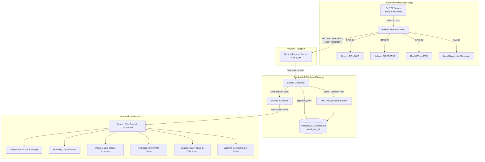

# SMART CAR HEAT AND HUMIDITY MONITORING AND ALERT SYSTEM USING ESP32
### MCA IoT Mini Project

[](https://opensource.org/licenses/MIT)
[](https://nodejs.org/)
[](https://react.dev/)
[](https://www.postgresql.org/)
[](https://www.docker.com/)
[](https://render.com/)

---

## 1. PROJECT INTRODUCTION

When a passenger vehicle is parked outdoors in direct sunlight, the interior cabin temperature can rise at alarming rates due to the greenhouse effect of automotive glass. Drivers and passengers frequently enter hot cabins without knowing the real-time temperature, which can cause severe thermal discomfort and dehydration.

This project delivers a **full-stack IoT solution** using an **ESP32 microcontroller** paired with a **DHT22 digital sensor** to continuously track internal temperature and humidity. Readings are communicated over Wi-Fi to a containerized Node.js backend, stored in PostgreSQL, and streamed in real time to a high-aesthetic automotive dashboard via Socket.IO.

> **Academic Prototype Notice:** This system is an educational monitoring prototype designed for MCA coursework. It is not an automotive-certified life-safety system and does not make medical safety determinations.

---

## 2. PROBLEM STATEMENT

1. **Extreme Cabin Heat Rise:** Solar radiation entering closed vehicles causes interior temperatures to climb beyond 40°C–50°C within minutes.
2. **Lack of Driver Visibility:** Drivers approaching or boarding a vehicle have no remote mechanism to verify interior ambient temperature.
3. **Absence of Stored Environmental Analytics:** Existing commercial vehicles rarely provide telemetry history regarding thermal stress and humidity conditions over time.

---

## 3. OBJECTIVES

1. Interfacing a DHT22 high-precision sensor with an ESP32 microcontroller using GPIO pins.
2. Implementing rule-based hardware LED alerts (Green, Yellow, Red) representing three temperature tiers:
   - **NORMAL (< 30.0°C):** Green LED
   - **WARNING (30.0°C – 34.9°C):** Yellow LED
   - **HIGH (≥ 35.0°C):** Red LED
3. Transmitting sensor telemetry to a Node.js REST API using HTTP/HTTPS POST over Wi-Fi.
4. Persisting readings, alert transitions, and device statuses in PostgreSQL.
5. Broadcasting live readings to a React.js automotive dashboard via WebSockets (Socket.IO).
6. Containerizing the complete stack using Docker Compose and supporting 1-click cloud deployment on Render.com.
7. Providing a development simulator mode to demonstrate heating and cooling cycles without physical hardware.

---

## 4. SYSTEM ARCHITECTURE



---

## 5. HARDWARE REQUIREMENTS & PIN CONNECTIONS

### Bill of Materials (BOM)
* 1x ESP32 DevKit V1 (30-pin or 38-pin)
* 1x DHT22 Temperature & Humidity Sensor (AM2302)
* 1x Red 5mm LED
* 1x Yellow 5mm LED
* 1x Green 5mm LED
* 3x 220Ω Resistors (for LED current limiting)
* 1x 10kΩ Resistor (pull-up between DHT22 DATA and 3.3V for bare 4-pin modules)
* 1x Solderless Breadboard & Dupont Jumper Wires

### Exact ESP32 Pin Connections

| Component Pin | ESP32 GPIO Pin | Description / Notes |
| :--- | :--- | :--- |
| **DHT22 VCC** (Pin 1) | **3.3V** | Power rail supplied from ESP32 3.3V regulator |
| **DHT22 DATA** (Pin 2) | **GPIO 4** | Digital bidirectional single-bus signal line |
| **DHT22 NC** (Pin 3) | *Not Connected* | No connection on bare 4-pin sensors |
| **DHT22 GND** (Pin 4) | **GND** | Common system ground rail |
| **Red LED Anode (+)** | **GPIO 26** | Series with 220Ω resistor (High Alert ≥ 35°C) |
| **Yellow LED Anode (+)** | **GPIO 25** | Series with 220Ω resistor (Warning 30°C–34.9°C) |
| **Green LED Anode (+)** | **GPIO 27** | Series with 220Ω resistor (Normal < 30°C) |
| **All LED Cathodes (-)** | **GND** | Connected to common GND rail |

> **Important Wiring Note:** If using a bare 4-pin DHT22 sensor (AM2302 without PCB), you **must connect a 4.7kΩ to 10kΩ pull-up resistor** between DHT22 Pin 2 (DATA) and 3.3V rail. Pre-soldered 3-pin sensor breakout modules usually include this SMD resistor on board.

---

## 6. DATABASE DESIGN (POSTGRESQL)

The database `smart_car_iot` is structured with strict foreign keys, timestamp indexing, and constraint validation.

### Table 1: `devices`
Tracks monitored vehicles and active communication heartbeats.
```sql
CREATE TABLE devices (
    id SERIAL PRIMARY KEY,
    device_id VARCHAR(50) UNIQUE NOT NULL,
    device_name VARCHAR(100) NOT NULL DEFAULT 'Smart Car Sentinel',
    last_seen TIMESTAMPTZ DEFAULT CURRENT_TIMESTAMP,
    created_at TIMESTAMPTZ DEFAULT CURRENT_TIMESTAMP
);
```

### Table 2: `sensor_readings`
High-resolution environmental telemetry logs.
```sql
CREATE TABLE sensor_readings (
    id BIGSERIAL PRIMARY KEY,
    device_id VARCHAR(50) NOT NULL REFERENCES devices(device_id) ON DELETE CASCADE,
    temperature NUMERIC(5, 2) NOT NULL,
    humidity NUMERIC(5, 2) NOT NULL,
    status VARCHAR(20) NOT NULL CHECK (status IN ('NORMAL', 'WARNING', 'HIGH')),
    is_simulated BOOLEAN DEFAULT FALSE,
    recorded_at TIMESTAMPTZ NOT NULL DEFAULT CURRENT_TIMESTAMP
);
```

### Table 3: `alerts`
Stores threshold transition warning records without repetitive 5-second spam.
```sql
CREATE TABLE alerts (
    id BIGSERIAL PRIMARY KEY,
    device_id VARCHAR(50) NOT NULL REFERENCES devices(device_id) ON DELETE CASCADE,
    alert_type VARCHAR(50) NOT NULL CHECK (alert_type IN ('WARNING', 'HIGH', 'RESOLVED')),
    message TEXT NOT NULL,
    temperature NUMERIC(5, 2) NOT NULL,
    humidity NUMERIC(5, 2) NOT NULL,
    created_at TIMESTAMPTZ NOT NULL DEFAULT CURRENT_TIMESTAMP
);
```

---

## 7. BACKEND REST API DOCUMENTATION

Base URL: `http://localhost:3000` (Local) or `https://<YOUR-RENDER-APP>.onrender.com` (Cloud)

| Method | Endpoint | Purpose | Headers / Query |
| :--- | :--- | :--- | :--- |
| **POST** | `/api/sensor-data` | Ingest ESP32 or simulator readings | `x-api-key: smart-car-secret-key-2026` |
| **GET** | `/api/sensor-data` | Historical readings list | `?range=1h&limit=50&offset=0&status=HIGH` |
| **GET** | `/api/sensor-data/latest` | Latest reading + online status | `?device_id=CAR_001` |
| **GET** | `/api/sensor-data/stats` | Aggregated 24h metrics (min/max/avg) | `?device_id=CAR_001&range=24h` |
| **GET** | `/api/alerts` | Retrieve warning events history | `?device_id=CAR_001&limit=20` |
| **GET** | `/api/health` | Backend and database health status | None |
| **GET** | `/api/simulation/status` | Current state of telemetry simulator | None |
| **POST** | `/api/simulation/start` | Start telemetry simulation | `{ "mode": "heatwave" }` |
| **POST** | `/api/simulation/stop` | Stop telemetry simulation | None |

### Ingestion Payload Example
```json
POST /api/sensor-data
Headers:
  Content-Type: application/json
  x-api-key: smart-car-secret-key-2026

Body:
{
  "device_id": "CAR_001",
  "temperature": 38.5,
  "humidity": 62.5,
  "status": "HIGH"
}
```

---

## 8. STEP-BY-STEP GUIDE: HOSTING ON RENDER.COM

Deploying this project to [Render.com](https://render.com) allows your ESP32 to transmit data from anywhere with Wi-Fi, and lets anyone access your dashboard on a live HTTPS web URL!

### Option A: 1-Click Render Blueprint (Recommended)
This repository includes a `render.yaml` blueprint that configures PostgreSQL, Backend, and Frontend automatically:

1. Push this project to your **GitHub** account:
   ```bash
   git init
   git add .
   git commit -m "Initial commit for Smart Car IoT"
   git branch -M main
   git remote add origin https://github.com/<YOUR_USERNAME>/<YOUR_REPOSITORY>.git
   git push -u origin main
   ```
2. Log into **[dashboard.render.com](https://dashboard.render.com/)**.
3. Click **New +** &rarr; Select **Blueprint**.
4. Connect your GitHub repository.
5. Render will automatically read `render.yaml` and display:
   - `smart-car-postgres` (PostgreSQL Database - Free)
   - `smart-car-backend` (Node.js Web Service - Free)
   - `smart-car-frontend` (Static Site Dashboard - Free)
6. Click **Apply**.
7. Render will build and deploy all 3 components!

---

### Option B: Manual Setup on Render (Step-by-Step)

If you prefer setting up each component manually on Render:

#### Step 1: Create PostgreSQL Database on Render
1. In Render Dashboard, click **New +** &rarr; **PostgreSQL**.
2. **Name:** `smart-car-postgres`
3. **Database:** `smart_car_iot`
4. **User:** `smart_car_user`
5. **Region:** Oregon (or closest to you)
6. **Plan:** Free
7. Click **Create Database**.
8. After it is created, copy the **Internal Database URL** (e.g. `postgres://...`).

#### Step 2: Deploy Backend Web Service
1. In Render Dashboard, click **New +** &rarr; **Web Service**.
2. Select your GitHub repository.
3. Configure the following settings:
   - **Name:** `smart-car-backend`
   - **Region:** Same as database (e.g. Oregon)
   - **Root Directory:** `backend`
   - **Runtime:** `Node`
   - **Build Command:** `npm install`
   - **Start Command:** `npm start`
   - **Plan:** Free
4. Add **Environment Variables**:
   - `NODE_ENV` = `production`
   - `DATABASE_URL` = Paste your database Internal Database URL
   - `DEVICE_API_KEY` = `smart-car-secret-key-2026`
   - `TEMP_NORMAL_THRESHOLD` = `30.0`
   - `TEMP_HIGH_THRESHOLD` = `35.0`
   - `OFFLINE_TIMEOUT_SECONDS` = `20`
   - `ENABLE_SIMULATION` = `true`
   - `CORS_ORIGIN` = `*`
5. Click **Create Web Service**.
6. Copy your live backend URL (e.g., `https://smart-car-backend.onrender.com`).

#### Step 3: Deploy Frontend Static Site
1. In Render Dashboard, click **New +** &rarr; **Static Site**.
2. Select your GitHub repository.
3. Configure:
   - **Name:** `smart-car-frontend`
   - **Root Directory:** `frontend`
   - **Build Command:** `npm install && npm run build`
   - **Publish Directory:** `dist`
4. Add **Environment Variables**:
   - `VITE_API_BASE_URL` = `https://smart-car-backend.onrender.com` (Your Backend URL)
   - `VITE_SOCKET_URL` = `https://smart-car-backend.onrender.com` (Your Backend URL)
5. Add **Rewrite Rule** under Redirects/Rewrites:
   - Source: `/*`
   - Destination: `/index.html`
   - Action: `Rewrite`
6. Click **Create Static Site**.
7. Access your dashboard live at `https://smart-car-frontend.onrender.com`!

---

### Step 4: Configure ESP32 for Render Cloud URL

Open `esp32/smart_car_monitor.ino` and update line 59:

```cpp
// Change from local IP to your Render backend HTTPS URL:
const char* serverURL = "https://smart-car-backend.onrender.com/api/sensor-data";
const char* deviceApiKey = "smart-car-secret-key-2026";
const char* ssid = "YOUR_WIFI_OR_MOBILE_HOTSPOT";
const char* password = "YOUR_WIFI_PASSWORD";
```

> **ESP32 HTTPS Notice:** The sketch in `esp32/smart_car_monitor.ino` is already programmed with `WiFiClientSecure` and `client.setInsecure()`, so it automatically handles Render's secure `https://` connection without needing any manual SSL certificates!

---

## 9. LOCAL RUNNING WITH DOCKER DESKTOP (WINDOWS)

To run the complete application locally using Docker:

### Prerequisites
* Windows 10/11 with **Docker Desktop** installed and running
* Git installed

### 1. Find Your Computer's IPv4 Address
Open PowerShell or Command Prompt and run:
```powershell
ipconfig
```
Look for **IPv4 Address** under your active Wi-Fi adapter (e.g. `192.168.1.15`).

### 2. Start Containers
In the project root folder:
```bash
docker compose up --build -d
```

### 3. Verify Containers
```bash
docker compose ps
```
You should see:
- `smart_car_postgres` (healthy on port 5432)
- `smart_car_backend` (running on port 3000)
- `smart_car_frontend` (running on port 8080)

### 4. Access Local URLs
* **React Dashboard:** [http://localhost:8080](http://localhost:8080)
* **Backend API Health:** [http://localhost:3000/api/health](http://localhost:3000/api/health)
* **Local ESP32 Portal:** `http://<ESP32_IP>/`

---

## 10. ARDUINO IDE SETUP FOR ESP32

1. Open **Arduino IDE** (v2.x recommended).
2. Go to **File &rarr; Preferences**.
3. In **Additional boards manager URLs**, add:
   ```
   https://raw.githubusercontent.com/espressif/arduino-esp32/gh-pages/package_esp32_index.json
   ```
4. Go to **Tools &rarr; Board &rarr; Boards Manager**, search for `esp32` and click **Install**.
5. Install required libraries via **Sketch &rarr; Include Library &rarr; Manage Libraries**:
   - `DHT sensor library` by Adafruit
   - `Adafruit Unified Sensor` by Adafruit
6. Select your board under **Tools &rarr; Board &rarr; ESP32 Arduino &rarr; ESP32 Dev Module**.
7. Connect your ESP32 via USB and select the correct **COM Port**.
8. Open `esp32/smart_car_monitor.ino`, adjust Wi-Fi and server URL, and click **Upload**.
9. Open **Serial Monitor** at **115200 baud** to view real-time diagnostics.

---

## 11. TESTING & VERIFICATION CHECKLIST

| Test ID | Objective | Expected Result | Verified In |
| :--- | :--- | :--- | :--- |
| **Test 1** | ESP32 Sensor Reading | DHT22 output printed in Serial Monitor every 5s | Hardware Serial |
| **Test 2** | LED Hardware Status | Green (<30°C), Yellow (30-35°C), Red (≥35°C) | Physical Breadboard |
| **Test 3** | Wi-Fi Auto-reconnect | Reconnects to router if signal is lost | Serial Monitor |
| **Test 4** | HTTP/HTTPS Delivery | ESP32 sends JSON payload with HTTP 201 response | Serial & Backend Logs |
| **Test 5** | Database Persistence | Telemetry inserted into PostgreSQL `sensor_readings` | Automated Test Suite |
| **Test 6** | Docker Containers | All 3 containers boot with health checks passing | `docker compose ps` |
| **Test 7** | Real-Time Dashboard | Live gauges update instantly via Socket.IO | Web Browser |
| **Test 8** | Warning System | ≥35°C triggers Red LED and urgent ventilation banner | UI & Unit Tests |
| **Test 9** | Disconnection Handling | Dashboard shows OFFLINE if no packet arrives in 20s | UI & Watchdog Test |
| **Test 10** | Sensor Error Handling | NaN readings don't crash ESP32; Yellow LED blinks | Serial & Firmware |

---

## 12. RUNNING AUTOMATED UNIT TESTS

Run backend test suites locally without needing a live database:
```bash
cd backend
npm test
```
Result: **11/11 tests pass** validating status rules, input validation, and alert transitions.

---

## 13. DEMONSTRATION MODE (SIMULATOR)

To demonstrate the project to college examiners or professors without an ESP32:
1. Open the dashboard at `http://localhost:8080` or your Render URL.
2. Click **Demo Mode** in the top-right header.
3. Select **Scenario A: Sunny Day Heatwave** to witness:
   - Temperature climbing from 27°C &rarr; 32°C (Warning, Yellow LED) &rarr; 38.5°C (High Alert, Red LED)
   - Real-time graph curve updates
   - Urgent cabin warning message displayed
4. Click **Scenario B: AC Ventilation** to see the system recover back to Green LED (< 30°C).

---

## 14. TROUBLESHOOTING

| Problem | Root Cause | Solution |
| :--- | :--- | :--- |
| **DHT22 reads NaN / -999** | Missing pull-up resistor or loose wire | Ensure 10kΩ resistor between DATA (GPIO 4) and 3.3V. Check GND. |
| **ESP32 HTTP -1 Error** | ESP32 cannot reach computer IP | Verify ESP32 and PC are on the same Wi-Fi. Check Windows Firewall for port 3000. |
| **Render Webhook Sleeping** | Render free tier sleeps after 15 min inactivity | ESP32's 8s timeout will wake the service automatically on first POST. |
| **CORS Error in Browser** | Backend rejecting frontend origin | Set `CORS_ORIGIN=*` in backend environment variables. |

---

## 15. LICENSE
This project is open-source under the MIT License for educational purposes.
